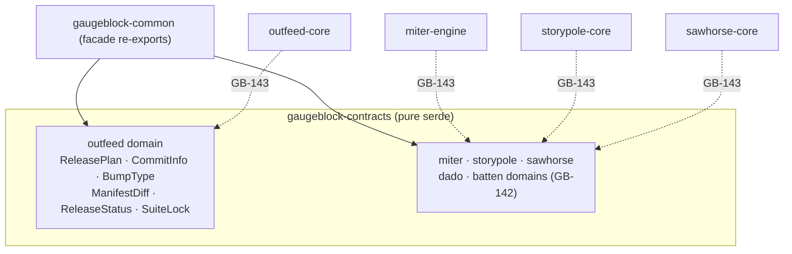
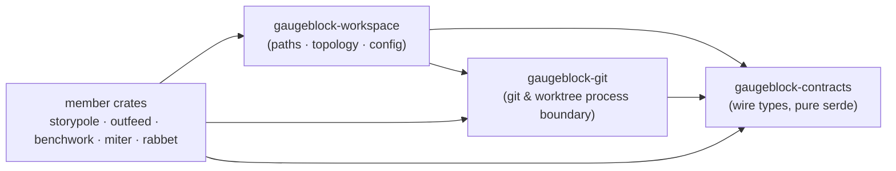

# Architecture — gaugeblock/common

> **Domain:** Shared wire contracts for the `gaugeblock` suite

---

## 1. Decomposition

## 2. Design rules

1. One crate (`gaugeblock-contracts`) holds every wire type; the facade crate exists so members can
   depend on `gaugeblock-common` without naming the sub-crate path.
2. Domains are submodules (`outfeed::*`, `storypole::*`) re-exported at the root, so consumers can
   glob-import without paying for unused domains at the type level.
3. Serialization is plain `serde` with field names taken verbatim from `CONTRACTS.md`. Optional fields
   that must vanish when absent carry `skip_serializing_if`.

## 3. Compile-time budget

| Crate | Dependencies | Cold build |
|:---|:---|:---|
| `gaugeblock-contracts` | `serde`, `serde_json` | ~2 s |
| `gaugeblock-common` | `gaugeblock-contracts` | re-export only |

## 4. Planned crates: the `git` / `workspace` boundary

Two crates are being lifted out of the members because the same logic is copied in four to six
repositories. Their split is the part that has to be decided once, up front, or the copies simply move
into a third place (`GB-131`, `GB-189`).

### `gaugeblock-git` — everything that spawns `git` or reasons about a repository

| Owns | Replaces |
|:---|:---|
| `common_dir` / worktree detection (`.git` file vs directory, `git rev-parse --git-common-dir`) | hand-rolled `.git` probing in `storypole-core::git`, `outfeed-core::git` |
| `worktree add / remove / prune / list` | `GB-169` (canonical `.gaugeblock` per worktree), `GB-170` (benchwork agent pool) |
| `rev-list` and tag/commit ranges (`commits_between`, `merge_base`, `describe`) | `storypole verify` receipts, `miter deps --since`, `rabbet` backfill |
| scoped `status` / `add` / `commit` / annotated `tag` with a single-round-trip `push` | `outfeed` release tagging, `benchwork` Panel 1 atomic doc commits (`GB-180`) |

Rules:

1. **No path policy.** The crate answers questions about a repository it is handed; it never decides
   *which* repository, never resolves `.gaugeblock/`, and never reads a workspace config.
2. **No suite vocabulary.** It knows branches, refs, commits and worktrees. It does not know what a
   `TaskNode` or a `ReleasePlan` is.
3. **Commands are arguments, never strings.** Every call takes typed arguments and returns typed
   results or a `thiserror` error carrying `git`'s stderr — no `format!`-built command lines.

### `gaugeblock-workspace` — which repository, and where its `.gaugeblock/` lives

| Owns | Replaces |
|:---|:---|
| `GaugeblockPaths` — worktree-safe canonical `.gaugeblock/` resolution | `storypole_core::store::spool_path` parent-walking, `outfeed` root guessing, `chalkline` `-d` heuristics |
| `WorkspaceTopology` — meta-harness root, the 11 member repositories, their `Cargo.toml` members | `chalkline --workspace`, `outfeed` suite manifests, `benchwork` repo enumeration |
| `SuiteConfig`, `env_credentials` — `.gaugeblock/config.toml` and `.env` loading | per-tool config parsing in `outfeed`, `benchwork`, `joiner`, `sawhorse` |

Rules:

1. **It may call `gaugeblock-git`; `gaugeblock-git` may never call it.** One direction only, so the
   crate graph stays acyclic.
2. **`.gaugeblock/` never splits inside a worktree.** Resolution goes through
   `git rev-parse --git-common-dir` rather than walking up from `current_dir`, which is what makes
   `GB-169`'s canonical-store promise true instead of aspirational.
3. **Discovery returns data, not actions.** `WorkspaceTopology` reports members and their manifests;
   building, testing and releasing them stays in the member that owns the policy.

Adoption so far (`GB-189` step 3, one repository per commit): `benchwork` (hub status, credentials,
config consolidator, migration preview - 6 sites), `storypole` (unified config in two loaders, root
ledger - 3), `sawhorse` (dotenv), `chalkline` (docs.toml read and write), `miter` (unified and tool
config), `joiner` (spool).

**Sites that stay behind on purpose.** A grep for `.gaugeblock` still finds hits, and they are not
all debt. Two shapes must not be converted:

- *Descriptive* paths inside a plan - `benchwork`'s `MigrationItem` records where a file *will go*, is
  reported to a user, and is replayed against a root later. Resolving those would hand the plan
  absolute paths and change its data rather than its meaning.
- *Policy* fallbacks - `storypole::store` prefers `.gaugeblock/storypole` and falls back to the legacy
  `.storypole`, walking up to the nearest ancestor holding either; `miter::storage::workspace`,
  `joiner::model`, `dado::init` and `outfeed::storypole` do the same at smaller scale. Replacing a walk
  with a git-common-dir lookup changes which checkouts are found, so each is its own commit with its
  own tests rather than a rename that reads as mechanical.

Consequently the ticket's "63 derivations" figure counts path literals, not migrations.

All four types have now shipped - `GaugeblockPaths`, `WorkspaceTopology`, `MemberRepo`, `SuiteConfig`
- with `env_credentials` for callers that want a provider key and have no use for the parsed table.
`sawhorse` is the first consumer of the credential rules: it read the canonical dotenv through a
private copy of them, so the two agreed only by coincidence. Its legacy plain `.env` fallback stays
local, because parsing it here is cheaper than making the crate keep a second format.

**Adoption still open:** `benchwork`, `outfeed` and `joiner` each parse a `[tool]` table out of
`config.toml` themselves. Moving them is a behaviour change per tool - each has its own fallback
ladder - so it belongs in its own tickets rather than being swept in with the type work.

### `gaugeblock-security` — redaction every product may use

Extracted from `miter` in `GB-158`, pulled forward by `GB-204`. It has **no dependencies at all**, which
is exactly why it belongs here: `rabbet` and `joiner` both needed `scrub_source_text`, and reaching into
another product's engine for a std-only helper is a lateral edge that buys nothing. `rabbet-core ->
miter-engine` existed solely for that call and is now a downward edge to this crate.

Rules:

1. **Foundation, not product.** Redaction is not a miter concern; anything that writes telemetry, spools
   or logs needs it.
2. **No dependencies, ever.** A dependency here would make every consumer of redaction inherit it.
3. **`miter` re-exports it as `security`**, so paths written before the move still resolve.

### `gaugeblock-mcp` — how a server speaks JSON-RPC

| Owns | Replaces |
|:---|:---|
| `RpcRequest`, `RpcResponse`, `ToolOutcome`, error codes, `PROTOCOL_VERSION` | the `json!` literals each server built by hand |
| `route` + `McpHandler` / `AsyncMcpHandler` | the seven copies of the `match method` ladder |
| `serve` / `serve_async` / `handle_line` | the seven stdin loops, including their failure paths |

Rules:

1. **The transport owns the wire, the tool layer owns the data.** A tool returns `ToolOutcome::Json`,
   `Text` or `Failed`; building the MCP `content` envelope is not a tool's job. All seven servers now
   comply - `batten`, `joiner` and `benchwork` returned finished envelopes until `GB-234` converted
   their dispatchers, and the transitional `Raw` variant that carried them is deleted.
2. **A malformed line is answered, not dropped.** `-32700` with `id: null`, then the loop continues.
   One bad message must not end a session, and silence is indistinguishable from a hang.
3. **A failed tool is a successful call.** MCP reserves `error` for protocol faults, so a tool failure
   travels in `content` with `isError`. Only routing faults produce a JSON-RPC `error`.
4. **Routing is shared by both loops.** `serve` and `serve_async` classify requests through `route`, so
   the asynchronous servers cannot answer `initialize` differently from the synchronous ones - which is
   how the original seven drifted.
5. **No executor dependency.** `serve_async` is a plain `async fn` over `std::future::Future`; the
   caller's runtime drives it.

Adoption (`GB-130`): all seven stdio servers - `batten`, `joiner`, `outfeed`, `benchwork`,
`storypole`, `chalkline`, `dado`. `miter` keeps a typed `JsonRpcRequest`/`JsonRpcResponse` pair of its
`own and is the remaining copy; migrating it is a design change to a typed protocol rather than a loop
replacement, and is deferred.

### Model metadata is owned outside the suite (`GB-217`)

One boundary is not in `common/` at all, and it is worth stating next to the others because it has the
same shape. **Model metadata belongs to the published `models-catalog` crate**, not to a sibling
repository and not to a hand-maintained list:

| Question | Owner |
|:--|:--|
| What models exist, their context and output limits, modalities, prices | `models-catalog` (external crate, published) |
| Which ids the subscription covers, and their billing tier | `models-catalog` curated overlay |
| How a protocol encodes a reasoning request | `models-catalog` (`to_wire_reasoning_params`) |
| Which effort to ask for, and how much budget to spend | **sawhorse** (policy) |
| The closed set of effort tiers on the wire | `gaugeblock-contracts::ReasoningEffort` |

The rule that keeps this clean: **the crate answers, the suite decides.** `sawhorse` consumes catalog
answers with the dependency behind an off-by-default feature, so a hermetic build compiles without it
and falls back to the operator's declared config. Declaring limits by hand is the fallback, never the
source of truth - the hand-written 1M window and 32k cap that started this work were both wrong about
the model.

One deliberate exception lives in `sawhorse`: `ReasoningEffort::None` short-circuits before the catalog
is consulted. Clamping is right for choosing among *efforts*, but `none` is a caller policy about
spending budget on thinking, and the catalog clamps it up to the nearest supported tier.

### What must **not** appear in `common/`

Anything that needs a clock, a subprocess or a network is fine in `gaugeblock-git` (it is a process
boundary by design) but every result must be a value. Neither crate may depend on a member
repository; the dependency direction is always member -> common.

