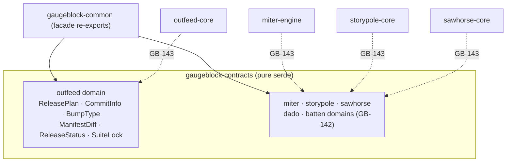

# Architecture — gaugeblock/common

> **Domain:** Shared wire contracts for the `gaugeblock` suite

---

## 1. Decomposition

## 2. Design rules

1. One crate (`gaugeblock-contracts`) holds every wire type; the facade crate exists so members can
   depend on `gaugeblock-common` without naming the sub-crate path.
2. Domains are submodules (`outfeed::*`, `storypole::*`) re-exported at the root, so consumers can
   glob-import without paying for unused domains at the type level.
3. Serialization is plain `serde` with field names taken verbatim from `CONTRACTS.md`. Optional fields
   that must vanish when absent carry `skip_serializing_if`.

## 3. Compile-time budget

| Crate | Dependencies | Cold build |
|:---|:---|:---|
| `gaugeblock-contracts` | `serde`, `serde_json` | ~2 s |
| `gaugeblock-common` | `gaugeblock-contracts` | re-export only |
