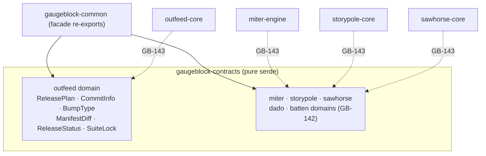
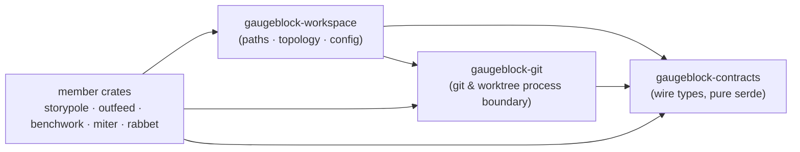

# Architecture — gaugeblock/common

> **Domain:** Shared wire contracts for the `gaugeblock` suite

---

## 1. Decomposition

## 2. Design rules

1. One crate (`gaugeblock-contracts`) holds every wire type; the facade crate exists so members can
   depend on `gaugeblock-common` without naming the sub-crate path.
2. Domains are submodules (`outfeed::*`, `storypole::*`) re-exported at the root, so consumers can
   glob-import without paying for unused domains at the type level.
3. Serialization is plain `serde` with field names taken verbatim from `CONTRACTS.md`. Optional fields
   that must vanish when absent carry `skip_serializing_if`.

## 3. Compile-time budget

| Crate | Dependencies | Cold build |
|:---|:---|:---|
| `gaugeblock-contracts` | `serde`, `serde_json` | ~2 s |
| `gaugeblock-common` | `gaugeblock-contracts` | re-export only |

## 4. Planned crates: the `git` / `workspace` boundary

Two crates are being lifted out of the members because the same logic is copied in four to six
repositories. Their split is the part that has to be decided once, up front, or the copies simply move
into a third place (`GB-131`, `GB-189`).

### `gaugeblock-git` — everything that spawns `git` or reasons about a repository

| Owns | Replaces |
|:---|:---|
| `common_dir` / worktree detection (`.git` file vs directory, `git rev-parse --git-common-dir`) | hand-rolled `.git` probing in `storypole-core::git`, `outfeed-core::git` |
| `worktree add / remove / prune / list` | `GB-169` (canonical `.gaugeblock` per worktree), `GB-170` (benchwork agent pool) |
| `rev-list` and tag/commit ranges (`commits_between`, `merge_base`, `describe`) | `storypole verify` receipts, `miter deps --since`, `rabbet` backfill |
| scoped `status` / `add` / `commit` / annotated `tag` with a single-round-trip `push` | `outfeed` release tagging, `benchwork` Panel 1 atomic doc commits (`GB-180`) |

Rules:

1. **No path policy.** The crate answers questions about a repository it is handed; it never decides
   *which* repository, never resolves `.gaugeblock/`, and never reads a workspace config.
2. **No suite vocabulary.** It knows branches, refs, commits and worktrees. It does not know what a
   `TaskNode` or a `ReleasePlan` is.
3. **Commands are arguments, never strings.** Every call takes typed arguments and returns typed
   results or a `thiserror` error carrying `git`'s stderr — no `format!`-built command lines.

### `gaugeblock-workspace` — which repository, and where its `.gaugeblock/` lives

| Owns | Replaces |
|:---|:---|
| `GaugeblockPaths` — worktree-safe canonical `.gaugeblock/` resolution | `storypole_core::store::spool_path` parent-walking, `outfeed` root guessing, `chalkline` `-d` heuristics |
| `WorkspaceTopology` — meta-harness root, the 11 member repositories, their `Cargo.toml` members | `chalkline --workspace`, `outfeed` suite manifests, `benchwork` repo enumeration |
| `SuiteConfig` — `.gaugeblock/config.toml` and `.env` loading | per-tool config parsing in `outfeed`, `benchwork`, `joiner` |

Rules:

1. **It may call `gaugeblock-git`; `gaugeblock-git` may never call it.** One direction only, so the
   crate graph stays acyclic.
2. **`.gaugeblock/` never splits inside a worktree.** Resolution goes through
   `git rev-parse --git-common-dir` rather than walking up from `current_dir`, which is what makes
   `GB-169`'s canonical-store promise true instead of aspirational.
3. **Discovery returns data, not actions.** `WorkspaceTopology` reports members and their manifests;
   building, testing and releasing them stays in the member that owns the policy.

### What must **not** appear in `common/`

Anything that needs a clock, a subprocess or a network is fine in `gaugeblock-git` (it is a process
boundary by design) but every result must be a value. Neither crate may depend on a member
repository; the dependency direction is always member -> common.

